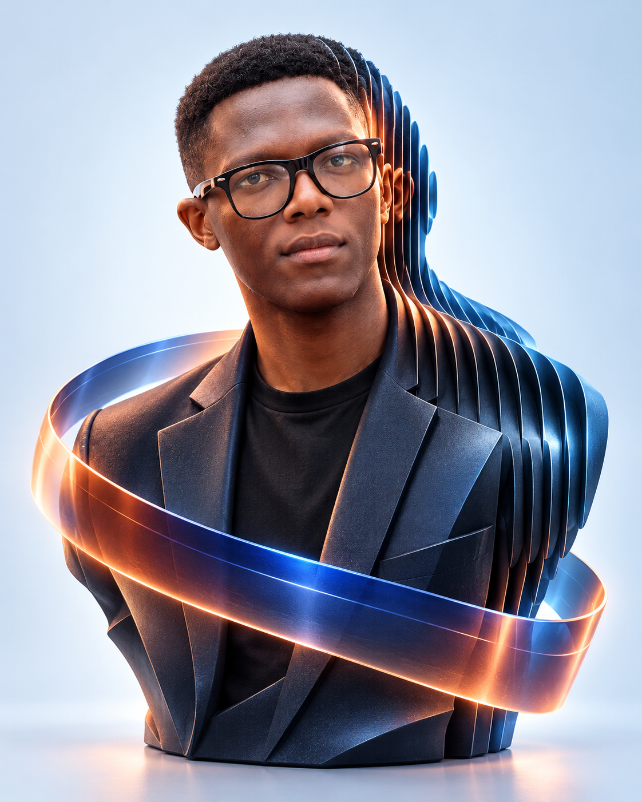

# 003 — Joshua as a sculptural identity

- **Status:** REJECTED by the owner. Retained as revision history; do not integrate. No website integration or animation performed.
- **Date:** 1 November 2026.
- **Tool:** Built-in `image_gen`, identity-preserving edit using the original portrait and the owner's supplied style reference.

The owner authorises creatively manipulating their picture toward the supplied dimensional bust reference. The reference establishes an interest in sculpture, layered geometry, optical light and flowing ribbons. Its branding, website layout, metrics and exact model are not part of Joshua's design.

The owner did not approve this study and requested a more creative concept. It is no longer the active direction. See [the three new alternatives](004-portrait-concept-alternatives.md); those are proposals, with no final treatment selected yet.

## First study

- Recognisable face and rectangular glasses remain the centre of attention.
- Asymmetric contour layers extend through the right/back of the head, neck and tailored jacket.
- Petrol/graphite surfaces and cobalt/copper light connect precision with expression.
- One broad ribbon passes behind and in front of the bust with deliberate occlusion.
- Text remains separate, so the website's name, roles and links can be real accessible content.

Files:

- [Rendered study](assets/joshua-sculptural-study-v1.png), 1122 × 1402 pixels.
- [Exact generation prompt](assets/joshua-sculptural-study-v1.prompt.txt).
- [Asset provenance](assets/joshua-sculptural-study-v1.json).
- [Owner-supplied style reference](references/sculptural-portrait-reference.png), retained for internal visual reference.

The original `public/images/joshua.webp` is unchanged. No Google account, external asset service or paid tool was used.

## Animation implications

This output is a **single raster concept render**, not an editable head mesh, 3D scan or separated composition. It supports layout tests and a bounded image-based reveal immediately. Independent slice movement, a head orbit or changing ribbon occlusion requires additional separated assets or actual geometry.

The most useful first motion proof would establish the bust, shift attention through a controlled light/mask transition, then resolve into real work and the two portfolio entrances. Test a static composition and phone framing before generating more assets. Keep the strong likeness and coherent silhouette through each shot.

Review the degree of face stylisation, layer spacing, ribbon prominence and desktop/phone silhouette. Once those choices are settled, prepare the required layer set or geometry and the remaining storyboard frames. Avoid interpreting visual approval of this image as proof that its parts are already independently animatable.
