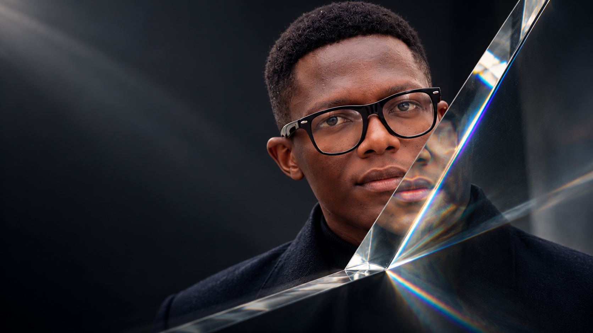
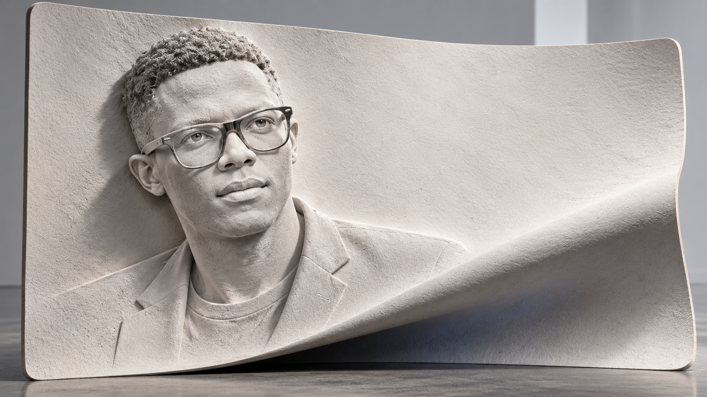
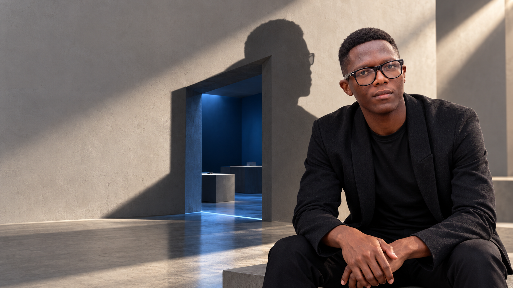

# 004 — New portrait concepts after the first rejection

- **Status:** REFRACTION SELECTED FOR DEVELOPMENT by the owner on 1 November 2026. Imprint and The Impossible Shadow are unselected studies. No finished asset or animation is approved by this selection.
- **Date:** 1 November 2026.
- **Production:** Built-in `image_gen`, using only Joshua's original portrait as the identity reference. The rejected bust was not used as an image reference.

The owner rejected the first sliced-bust/ribbon concept and asked for more creative thinking, then explicitly chose **Refraction** from these three studies. That decision overrides the earlier design recommendation of The Impossible Shadow. These full-width art studies preserve the alternatives and their provenance; the active production direction is [001](001-cinematic-portfolio-direction.md), with the local motion proof scoped in [005](005-refraction-motion-proof.md).

## Refraction

**Selected for development.** Use this optical portrait idea for the local proof; refine the actual glass and motion before treating it as a finished asset.

Joshua's characteristic glasses inspire an architectural optical surface. A large prism introduces controlled displacement and spectral light, while the main face stays readable. The composition supports a dark editorial entrance with calm space for real typography.

**Selected motion hypothesis:** portrait → optical edge → real work → two portfolios. A controlled optical edge travels across the portrait and becomes the boundary of a project presentation. A genuinely changing refraction requires actual geometry or a controlled shader using clean portrait/work inputs; the still does not contain those assets. Keep the real face and characteristic glasses recognisable, with graphite surroundings, optically clear glass and a subtle spectral edge.

[Exact prompt](assets/joshua-v2-refraction.prompt.txt) · [Provenance](assets/joshua-v2-refraction.json)

## Imprint

**Unselected study — retained for reference only.**

The portrait is formed from a continuous mineral-white surface. Its broad fold creates the composition and a possible handoff into the work. This explores a tactile, sculptural identity with a materially different silhouette and atmosphere.

**Motion hypothesis:** raking light establishes the relief, then the surface unfolds into project imagery. Unfolding the actual relief requires authored geometry or a controlled compositing transition. The current rough material treatment is a study, not a final material specification.

[Exact prompt](assets/joshua-v3-imprint.prompt.txt) · [Provenance](assets/joshua-v3-imprint.json)

## The Impossible Shadow

**Unselected study — retained for reference only.**

A human portrait anchors an architectural composition. The cast shadow joins a deep opening into a blue interior. The surrounding space supplies the unusual visual event and gives a later camera move a concrete destination.

**Motion hypothesis:** the portrait establishes identity; the shadow/opening becomes the route into the work, ending at the two portfolio entrances. Initial movement can use modest layered depth; a deeper passage needs actual geometry or an authored sequence. Do not stretch a flattened portrait plate to simulate unrestricted camera movement.

**Previous recommendation, superseded:** this was initially recommended for its person-to-work passage. The owner's explicit selection of Refraction now determines the direction; do not carry Shadow's room/passage or Imprint's sculptural material into the active brief.

[Exact prompt](assets/joshua-v4-impossible-shadow.prompt.txt) · [Provenance](assets/joshua-v4-impossible-shadow.json)

## Shared boundaries

The original portrait remains preserved. All three outputs are raster concept images, not editable meshes or completed animations. Refraction now moves into an isolated local `/lab/refraction/` proof, with independent phone composition, clean portrait layers and authored glass geometry or a controlled shader. Its selection does not demonstrate achieved prototype quality or authorise replacing the live homepage before the proof is reviewed. Keep names, role text, links and real work as accessible page content.
